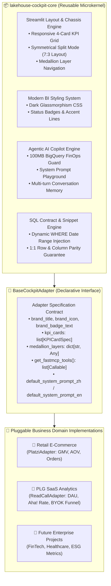

# Lakehouse Cockpit Core 🏛️⚡

[](pyproject.toml)
[](https://streamlit.io)
[](components/ai_drawer.py)
[](#2-architecture-overview)
[](LICENSE)

> **A production-grade, reusable microkernel framework for Modern Medallion Lakehouse BI Analytics and FastMCP / Gemini AI Operations Copilots.**  
> Decouple 85% of boilerplate UI, layout orchestration, FinOps guards, and SQL contract engines from your business domain models. Build and launch a new enterprise analytics cockpit in under 30 minutes.

---

## Table of Contents
- [1. Why Lakehouse Cockpit Core?](#1-why-lakehouse-cockpit-core)
- [2. Architecture Overview](#2-architecture-overview)
- [3. Key Architectural Features](#3-key-architectural-features)
  - [3.1 Responsive 4-Card Executive KPI Grid](#31-responsive-4-card-executive-kpi-grid)
  - [3.2 3-Layer Medallion Lakehouse Navigator](#32-3-layer-medallion-lakehouse-navigator)
  - [3.3 Dynamic SQL & Table Snippet Contract Engine](#33-dynamic-sql--table-snippet-contract-engine)
  - [3.4 Symmetrical Agentic AI Copilot Drawer](#34-symmetrical-agentic-ai-copilot-drawer)
  - [3.5 Interactive System Prompt Playground](#35-interactive-system-prompt-playground)
- [4. Quick Start: Building a Domain Adapter](#4-quick-start-building-a-domain-adapter)
- [5. Git Submodule Workflow & Multi-Project Synchronization](#5-git-submodule-workflow--multi-project-synchronization)
- [6. Real-World Implementations](#6-real-world-implementations)
- [7. Contributing & Development](#7-contributing--development)

---

## 1. Why Lakehouse Cockpit Core?

When building data analytics platforms across different business verticals (Retail E-Commerce, PLG SaaS, FinTech, Healthcare), data teams repeatedly spend **80%+ of their development cycles writing boilerplate scaffolding**:
- Re-coding Streamlit columns, responsive CSS cards, hover shadows, and font typography.
- Re-wiring date range filters, sidebar navigation, and language localization toggles.
- Re-implementing LLM chat containers, API key handling, and tool-calling wrappers.
- Hand-crafting SQL query display expanders and table previews that frequently desynchronize from actual chart projections.

**The Solution:**  
`lakehouse-cockpit-core` implements the **Microkernel + Domain Adapter Pattern**. The core library acts as an unopinionated runtime chassis containing the layout engine, agentic copilot, and data contracts. Each business domain simply provides a lightweight, declarative **Domain Adapter** specifying brand metadata, KPI formulas, layer views, and callable tools.

---

## 2. Architecture Overview



---

## 3. Key Architectural Features

### 3.1 Responsive 4-Card Executive KPI Grid
- **Glassmorphism Visual Hierarchy**: Adaptive cards with 4px top accent color highlights.
- **Automated Health Status Pills**: Evaluates threshold rules (`normal` vs `warning`) with auto-styled emerald and crimson badges.
- **Metric Formula Tags**: Monospace semantic formula tags (`SUM(gross_amount)`, `aha_users / dau`) directly above target thresholds for instant clarity.

### 3.2 3-Layer Medallion Lakehouse Navigator
- Seamlessly navigates Kimball-standard Medallion data lakehouse layers:
  - **🥇 Gold Marts**: Business aggregations, executive trends, funnel drop-off curves, and cohort retention.
  - **🥈 Silver Layer**: Cleaned, standardized dimensional models (Fact tables ⨝ Dimension tables).
  - **🥉 Bronze Layer**: Append-only ingestion logs, raw payloads, and pipeline synchronization history.

### 3.3 Dynamic SQL & Table Snippet Contract Engine
- **Eliminates Code-to-Viz Desynchronization**: Prevents static SQL queries from showing hardcoded ranges or artificial `LIMIT 5` truncations while charts show dynamic timeframes.
- **Dynamic Date Injection**: Automatically compiles active sidebar date filters into valid BigQuery / DuckDB SQL:
  ```sql
  WHERE event_date BETWEEN '{start_str}' AND '{end_str}'
  ORDER BY event_date ASC;
  ```
- **1:1 Data Snippet Contract**: Table previews strictly match the generated SQL's column list, ordering, and row counts.

### 3.4 Symmetrical Agentic AI Copilot Drawer
- **7:3 Adaptive Split Mode**: Smoothly transitions the main BI canvas into an adaptive split layout when the AI copilot drawer is opened.
- **100MB FinOps Budget Guard**: Enforces strict maximum billing and byte-scan safety boundaries on all analytical queries to prevent cloud cost blowouts.
- **MBB Management Consultant Methodology**: Pre-configured with McKinsey, Bain, and BCG diagnostic principles (Pyramid Principle, Action Titles first, MECE profit trees, and 30-60-90 day tactical roadmaps).

### 3.5 Interactive System Prompt Playground
- An integrated, collapsible **System Prompt Playground** embedded directly within the AI interface.
- Allows executive users, recruiters, and analysts to inspect the active system prompt, live-edit instructions on the fly, apply customized rules, or reset to defaults with one click.

---

## 4. Quick Start: Building a Domain Adapter

Creating an enterprise analytics dashboard for a new business domain requires under 50 lines of code:

### Step 1: Install or Mount Submodule
```bash
git submodule add https://github.com/shin7965977/lakehouse-cockpit-core.git cockpit_core
```

### Step 2: Implement `BaseCockpitAdapter`
```python
# domain_adapter.py
from datetime import date
from typing import Any, Callable
import pandas as pd
from cockpit_core import BaseCockpitAdapter, KPICardSpec, MedallionTabSpec


class MyDomainAdapter(BaseCockpitAdapter):
    @property
    def project_id(self) -> str:
        return "my-gcp-project"

    @property
    def brand_title(self) -> str:
        return "Retail Executive Intelligence"

    @property
    def brand_icon(self) -> str:
        return "🛍️"

    @property
    def brand_badge_text(self) -> str:
        return "Cloud Lakehouse · 100MB FinOps"

    @property
    def default_language(self) -> str:
        return "en"

    @property
    def default_system_prompt_en(self) -> str:
        return "You are a senior retail management consultant..."

    @property
    def kpi_cards(self) -> list[KPICardSpec]:
        return [
            KPICardSpec(
                key="gmv",
                title_en="Gross Merchandise Value",
                metric_formula="SUM(gross_amount)",
                target_rule="≥ $100,000",
                calculate=lambda data: {
                    "value": f"${data['kpi']['gmv'].sum():,.2f}",
                    "status": "normal",
                },
            )
        ]

    def load_domain_data(
        self, start_date: date | None = None, end_date: date | None = None
    ) -> dict[str, pd.DataFrame]:
        # Connect to BigQuery or DuckDB and return domain tables
        return {"kpi": pd.DataFrame({"gmv": [125000.0]})}

    def get_fastmcp_tools(self) -> list[Callable]:
        return []

    @property
    def medallion_layers(self) -> dict[str, Any]:
        return {
            "gold": {
                "tabs": [
                    MedallionTabSpec(
                        tab_id="overview",
                        title_en="📊 Overview",
                        render_content=lambda data, is_en, adapter: None,
                    )
                ]
            }
        }
```

### Step 3: Launch in `dashboard.py`
```python
# dashboard.py
from cockpit_core import launch_cockpit_app
from domain_adapter import MyDomainAdapter

if __name__ == "__main__":
    launch_cockpit_app(adapter=MyDomainAdapter())
```

Run with:
```bash
streamlit run dashboard.py
```

---

## 5. Git Submodule Workflow & Multi-Project Synchronization

Because `lakehouse-cockpit-core` is managed as an independent Git repository, any feature enhancement developed in one downstream product can be cleanly synchronized back to all other platforms:

### 1. Upgrade Core in Downstream Projects
To pull the latest UI components, AI prompts, or bugfixes into your application:
```bash
git submodule update --remote cockpit_core
git add cockpit_core
git commit -m "chore: bump lakehouse-cockpit-core to latest release"
```

### 2. CI/CD Pipeline Best Practice
In GitHub Actions workflows, ensure `submodules: recursive` is declared so runners checkout the core chassis:
```yaml
- name: Checkout Code
  uses: actions/checkout@v4
  with:
    fetch-depth: 0
    submodules: recursive
```

---

## 6. Real-World Implementations

| Implementation Repository | Domain & Architecture | Live Application |
| :--- | :--- | :--- |
| [**data-pipeline-consulting-demo**](https://github.com/shin7965977/data-pipeline-consulting-demo) | **Platzi Retail E-Commerce** (ELT + Kimball Star Schema + Looker + FastMCP) | [](https://data-pipeline-consulting-demo-v01.streamlit.app/) |
| [**readcall-analytics-platform**](https://github.com/shin7965977/readcall-analytics-platform) | **ReadCall PLG SaaS** (BYOK Conversion Funnels + Aha! Moments + Viral Referral Loops) | [](https://readcall.app) |

---

## 7. Contributing & Development

```bash
# Clone the repository
git clone https://github.com/shin7965977/lakehouse-cockpit-core.git
cd lakehouse-cockpit-core

# Lint and format
ruff check .
ruff format --check .
```

---

## License
MIT License. Built with ❤️ for modern analytics engineering and agentic intelligence workflows.
